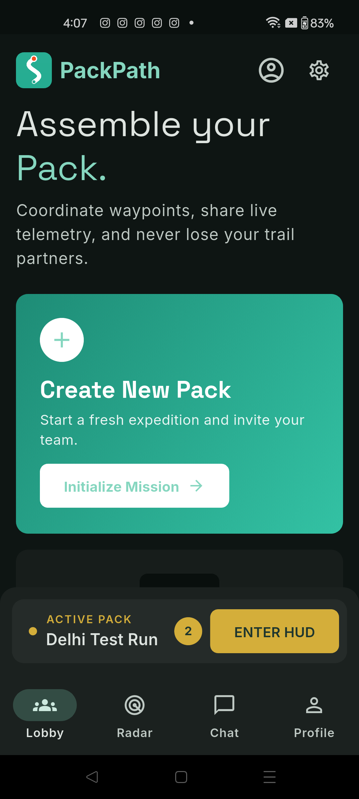
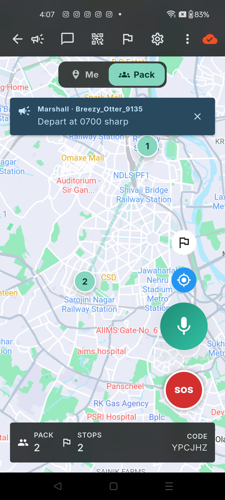
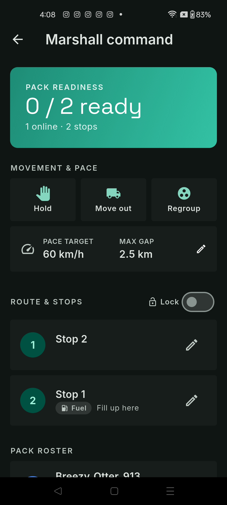
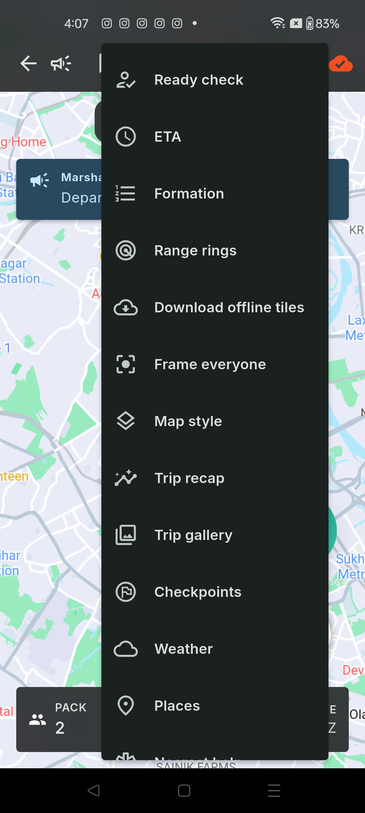

# PackPath

> Group navigation for coordinated trips. Real-time member location, push-to-talk voice, shared waypoints, per-member ETA, turn-by-turn navigation, offline tiles, NASA EONET hazard alerts, live road-hazard + detour voting, ratable places, shared checklists, achievements, expense splitting, trip recaps, and a dedicated **Marshall control center** for ride leaders. Flutter on iOS + Android, FastAPI backend, freemium with a Pro tier (₹149/mo) and GPX/ICS export. Self-hostable — one APK points at any backend you run.

PackPath fills the gap between Life360 (tracking, no nav), Google Maps (nav, no group view), and WhatsApp (chat, no maps). One app for a group heading somewhere together.

## Screenshots

<table>
  <tr>
    <td align="center"><br><sub>Lobby</sub></td>
    <td align="center"><br><sub>Live map &amp; HUD</sub></td>
    <td align="center"><br><sub>Marshall command</sub></td>
    <td align="center"><br><sub>Trip tools</sub></td>
  </tr>
</table>

Captured on-device (debug build) against the self-hosted backend.

## Current feature set (shipped, on `main`)

Everything in this list is live in `main` today and merges into every build. For aspirational items see `docs/ROADMAP.md`.

- **Auth** — phone OTP with JWT access + rotating refresh tokens.
- **Trips** — create, join by 6-char code, invite via `packpath://join/<code>` deep link, end, ghost mode.
- **Real-time member locations** — WebSocket fan-out via Redis pub/sub, TimescaleDB hypertable for history, adaptive client-side GPS sampling, heading arrow + battery arc per member.
- **Shared waypoints** — long-press on the map to add; reorder via swipe in the waypoints drawer.
- **Map tiles** — **Ola Maps** vector basemap as the default (India-tuned, with correct national borders), falling back to OpenStreetMap raster (no key required); Mapbox / Mappls / HERE / TomTom selectable when a token is configured in `lib/config/env.dart`. Native-SDK screens for Ola (MapLibre) and Google Maps are available where an SDK key is set. Hive-backed offline tile cache + bbox prefetcher.
- **Turn-by-turn navigation** — a dedicated nav screen with client-side maneuver detection from the route polyline, next-turn HUD, and distance/ETA readouts.
- **Per-member ETA** — `POST /trips/{id}/directions` proxies to Ola / Mapbox / Google / Mappls / HERE / TomTom / OSRM via a single resolver; ETA bottom sheet computes every member's arrival at the next waypoint.
- **LiveKit push-to-talk voice** — one room per trip, hold-to-talk gesture with pulse animation while broadcasting.
- **In-trip chat** — REST history + WS live frames, typing indicators, optimistic local echo, geofenced `arrival` system messages.
- **Expense splitting** — equal or weighted shares, integer cents, per-trip balance ledger.
- **Trip recap** — distance, moving time, stops, top speed, hour-of-day heatmap computed from the locations hypertable.
- **Onboarding** — 3-pillar Kinetic Path intro flow with a persisted "seen" flag.
- **Kinetic Path design system** — Material 3 theme built on bundled Space Grotesk + Inter variable TTFs, a **Sanzo Wada combination 250** palette (Sea Green teal primary `#25AC91`, Pyrite gold secondary `#D4AE3A`, Peach Red accent `#F34F20`), glassmorphism overlays via `ThemeExtension<KineticPathTokens>`. The launcher icon and web/adaptive icons share the same teal brand.
- **NASA EONET hazard overlay** — polled every 5 minutes via `GET /hazards`, rendered as category-specific map pins, slide-down proximity banner that fires when a hazard is within the per-category kilometre buffer of the active route.
- **Admin audit log + stats dashboard** — `/admin/analytics/*` (battery drain, provider health, ETA accuracy, WS lifetimes), `/admin/business/*` (MRR, funnel, churn), audit log reader.
- **Safety** — SOS button, client-side crash detector, server-side stranded + speed detection, full-screen alert sheet.
- **Live link for non-members** — mint a short-lived read-only JWT for a stripped trip snapshot URL.
- **Markable places** — long-press to mark fuel / food / repair / lodging / viewpoint / medical / ATM / water establishments; rate them 1–5★ with service tags and reviews. Places are global and reusable across every future trip; "Nearest help" finds the closest medical/repair/fuel.
- **Live pack awareness** — breadcrumb trails, live pace, straggler/cohesion HUD, range rings, formation order, low-battery and stale-location indicators, rally points, tap-to-nudge, and per-member status (moving / stopped / break / fuel).
- **Marshall control center** — a dedicated command screen for ride leaders: a readiness hero, movement controls (hold / move-out / regroup), target-pace and max-gap settings that drive the cohesion HUD, a reorderable route/stops builder with route-lock, and pack-roster ops (assign roles incl. co-marshall/sweep/driver, set vehicle label, mute, transfer marshall, remove). All marshall-only actions are gated server-side by a `require_marshall` dependency.
- **Scheduled announcements** — compose broadcasts to fire at a future time; a background sender posts them as pinned announcements and fans them out over the trip socket when due.
- **Document vault** — per-trip shared documents (links + notes) that the whole pack can view, add to, and manage.
- **Chat extras** — emoji reactions and named typing indicators over the trip socket; photo/video/file/location attachments; marshall announcements and ready-checks.
- **Safety resolve + emergency contacts** — "I'm safe / all clear" clears the pack-wide alert; per-user emergency contacts get an SMS with your live location on SOS.
- **Navigation (live)** — member-reported road hazards (pothole, accident, police, …) with severity + auto-expiry, and group **detour votes** (propose → yes/no tally → proposer resolves), all fanned out live.
- **Shared trip checklist** — packing / supplies / food / gear / to-do items that anyone can claim ("I've got it") and check off, synced live.
- **Gamification** — 32 activity-earned achievement badges and a per-trip leaderboard (distance + chat + hazards reported).
- **Personalization** — server-synced preferences (metric/imperial units, °C/°F, default map style, vehicle + mileage, default location-sharing).
- **Push & notification preferences** — FCM device registration with a preference- and quiet-hours-gated dispatcher; safety alerts always push. (On-device delivery activates once `FCM_SERVICE_ACCOUNT_JSON` is configured.)
- **Pro & integrations** — plan entitlements (`/me/entitlements`) with feature gating; Pro-gated **GPX** route export and **ICS** calendar export of a trip.
- **Self-host friendly** — the backend ships as a container (Dockerfile + entrypoint that waits for the DB, runs migrations, and starts uvicorn), wired into `infra/docker-compose.yml` alongside Postgres/PostGIS/TimescaleDB and Redis. The mobile app reads its server URL at runtime (Settings), so a single released APK — built and attached to a GitHub Release by the `Release APK` workflow on any `v*` tag — works against any backend you run. See [`infra/.env.example`](infra/.env.example).

## Architecture

```
         ┌────────────────────────┐
         │      PackPath app      │
         │  Flutter 3.41.4 iOS/An │
         └───────────┬────────────┘
                     │ HTTPS / WSS
                     ▼
     ┌──────────────────────────────┐
     │      PackPath backend        │
     │  FastAPI 0.115 · Python 3.11 │
     └──┬──────┬──────┬──────┬──────┘
        │      │      │      │
        ▼      ▼      ▼      ▼
   ┌─────┐┌─────┐┌─────┐┌──────────────────────────┐
   │ PG  ││Redis││Live ││ upstream APIs            │
   │ +   ││cache││Kit  ││  - Mapbox (tiles + dir)  │
   │PostGIS│rate ││voice││  - Ola / Google / Mappls │
   │ + TS ││limit││     ││    HERE / TomTom / OSRM │
   │ DB  ││     ││     ││  - NASA EONET (hazards,  │
   └─────┘└─────┘└─────┘│    15 min cache)         │
                        │  - MSG91 (OTP delivery)  │
                        │  - FCM (push, pref-gated)│
                        └──────────────────────────┘
```

See `docs/ARCHITECTURE.md` for the C4 levels, data flow diagrams, and security model.

## Repo layout

```
apps/backend    FastAPI service, Alembic migrations, pytest suite, Dockerfile
apps/mobile     Flutter app (iOS + Android + web scaffold)
docs            Architecture, roadmap, session findings, PRD
infra           docker-compose (Postgres/PostGIS/TimescaleDB + Redis + backend), .env.example
designs         Stitch mockups + Kinetic Path design system spec
.github         CI workflow (Flutter 3.41.4 pinned) + Release-APK workflow
```

## Local development

This README intentionally does not duplicate the per-package setup. See:

- [`apps/backend/README.md`](apps/backend/README.md) — FastAPI app, routers, env vars, pytest suite, local run instructions
- [`apps/mobile/README.md`](apps/mobile/README.md) — Flutter pin, module layout, theme, Mapbox token, pre-commit rules

For the full development story (infra spin-up, environment variables, migrations), start in the backend README and then swing over to the mobile README.

## CI

`.github/workflows/ci.yml` runs three jobs on every PR:

- **backend** — `ruff check app` + FastAPI import smoke test + `pytest -q`
- **mobile** — `flutter pub get`, `flutter analyze --no-fatal-infos --no-fatal-warnings`, `dart format --output=none --set-exit-if-changed lib`, and `flutter test`
- **alembic** — Postgres 16 + PostGIS + TimescaleDB up via service container, `alembic upgrade head`

Toolchain pin:

- **Flutter 3.41.4** stable, **Dart 3.11.1** (bundled). CI uses `subosito/flutter-action@v2` with an exact version match.
- **Python 3.11**, ruff pinned via requirements.
- **`dart format` is enforced** — if you commit a `.dart` file without running `dart format lib` first, the mobile job will fail.
- **`flutter analyze` is non-blocking on infos and warnings** — only hard errors fail the build. Infos land in the CI step summary for visible backlog without blocking PRs.
- **Backend pytest runs in CI** — the backend job installs `requirements-dev.txt` and runs `pytest -q` on every PR, alongside `ruff check app` and the import smoke test.
- **Mobile `flutter test` runs in CI** — unit tests under `apps/mobile/test` (e.g. `token_storage_test.dart`) execute on every PR, so a failing test fails the mobile job.

### Releases

`.github/workflows/release.yml` builds a release APK and attaches it to a GitHub Release whenever a `v*` tag is pushed (e.g. `git tag v1.0.0 && git push --tags`), or on manual `workflow_dispatch`. Users install the APK, then set their self-hosted server URL in the app on first run.

## Docs

- [`docs/ARCHITECTURE.md`](docs/ARCHITECTURE.md) — technical design
- [`docs/ROADMAP.md`](docs/ROADMAP.md) — session-by-session delivery log
- [`docs/PRD.md`](docs/PRD.md) — product requirements
- [`docs/PLAN_v1.1.md`](docs/PLAN_v1.1.md) — v1.1 advanced-features bundle spec
- [`docs/SESSION2_FINDINGS.md`](docs/SESSION2_FINDINGS.md) — Session 2 code smells (all resolved in PR #5, kept for history)
- [`designs/DESIGN_SYSTEM.md`](designs/DESIGN_SYSTEM.md), [`designs/DESIGN_TOKENS.md`](designs/DESIGN_TOKENS.md) — Kinetic Path brand

## License

Proprietary — all rights reserved.
